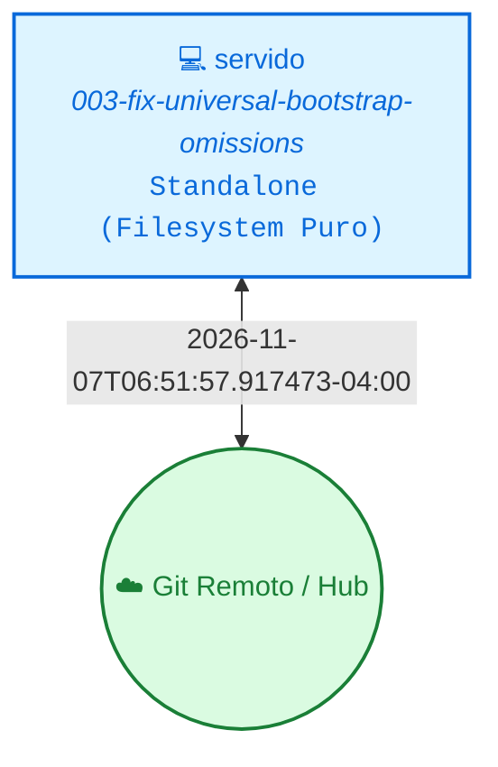

<!-- README.md | Atualizado em: 07-11-2026 06:55:02(GMT-04:00) -->

# 🧠 Painel de Contexto — vitalia-spec-kit

> **Vitalia SPEC Kit v0.0.1 — Ledger de Memória Persistente e Orquestração Local.**  
> Este repositório armazena o histórico distribuído, aprendizados consolidados e o controle de concorrência das sessões de trabalho do framework Vitalia.

---

## 📡 Topologia de Shards & Sincronização

---

## 🖥️ Máquinas e Status Atual

<table>
  <thead>
    <tr>
      <th align="left">Máquina / ID</th>
      <th align="left">Tarefa Atual</th>
      <th align="center">Ambiente</th>
      <th align="center">Status</th>
      <th align="left">Último Sync</th>
      <th align="left">Próximo Passo (P0)</th>
    </tr>
  </thead>
  <tbody>
    <tr>
      <td><strong>servido</strong> (<code>72a556ad</code>)</td>
      <td>003-fix-universal-bootstrap-omissions</td>
      <td align="center"></td>
      <td align="center">● Concluído</td>
      <td>2026-11-07T06:51:57.917473-04:00</td>
      <td><strong>Preparar release/tag ou iniciar a próxima spec sequencial do roadmap</strong></td>
    </tr>
  </tbody>
</table>

---

## 🎯 Sessão Ativa em Destaque

- **Estação Ativa:** `servido` (`72a556ad`)
- **Tarefa em Execução:** 003-fix-universal-bootstrap-omissions
- **🎯 Próximo Passo Prioritário (P0):** `Preparar release/tag ou iniciar a próxima spec sequencial do roadmap`
- **Última Sincronização:** `2026-11-07T06:51:57.917473-04:00`

---

## 📚 Histórico, Decisões & Guard Rails

<strong>🔍 Clique para expandir o Histórico Completo de Sessões</strong>

 

| Data / Hora | Estação (ID) | Tarefa Executada | Próximo Passo (P0) |
| :--- | :--- | :--- | :--- |
| 2026-11-07T06:51:57.914397-04:00 | `servido (-)` | 003-fix-universal-bootstrap-omissions | `Preparar release/tag ou iniciar a próxima spec sequencial do roadmap` |
| 2026-11-04T21:08:55.792475-04:00 | `servido (-)` | Spec 002: Universal Bootstrap & Runtime (v0.0.1) | `Iniciar ciclo SDD da Spec 003: Especialistas Verticais & Capacidades Especializadas` |
| 03-11-2026 05:47:37(GMT-04:00) | `ai-control (17a6f667)` | specs/001-sdd-judge-subagent | `Executar /vitalia-session-consolidate para consolidar os shards e renderizar o Dashboard` |

<strong>⚖️ Clique para expandir as Decisões Arquiteturais Consolidadas</strong>

 

| Máquina (ID) | Decisão Arquitetural | Impacto / Racional |
| :--- | :--- | :--- |
| `17a6f667` | **[246ef7bd]** `ARQUITETURA` Utilizar estritamente contratos JSON OpenAPI 3.0 puros (sem $schema, sem title e sem additionalProperties: false) | Evita erros de compilação HTTP 400 no compilador REST do Google Gemini. |
| `17a6f667` | **[ad0a2d82]** `ARQUITETURA` Adotar Sanduíche Constitucional (Primacy Bias P00-P20 e Recency Checklist) e Inverted CoT | Neutraliza attention loss em prompts longos e mitiga confirmação prematura via veredito emitido apenas ao final da crítica. |
| `17a6f667` | **[a439a5bb]** `ARQUITETURA` Executar o SDD-Judge como Sub-Agente nativo na IDE Antigravity com HITL soberano | Permite auditoria em janela de 1M-2M tokens com Sanduíche Constitucional sem perda de regras e sem travar a IDE. |

<strong>🛡️ Clique para expandir os Guard Rails de Grounding e Domínios</strong>

 

| Arquivo de Regras | Status | Domínios Monitorados | Pendentes de Curadoria HITL |
| :--- | :---: | :--- | :---: |
| `grounding_domains.yaml` (Global) | ✅ Ativo | `provedores_de_ia`, `python_packages`, `web_technologies`, `external_apis`, `security_practices`, `regulations_compliance`, `cloud_services`, `scientific_claims`, `clinical_safety`, `software_architecture` | — |
| `grounding-domains-local.yaml` (Projeto) | ✅ Sincronizado | Domínios locais específicos do workspace | `0 pendências` |

---

Painel gerado automaticamente pelo motor de contexto do Vitalia Kit (<code>vitalia_context_engine.py --action consolidate</code>).
