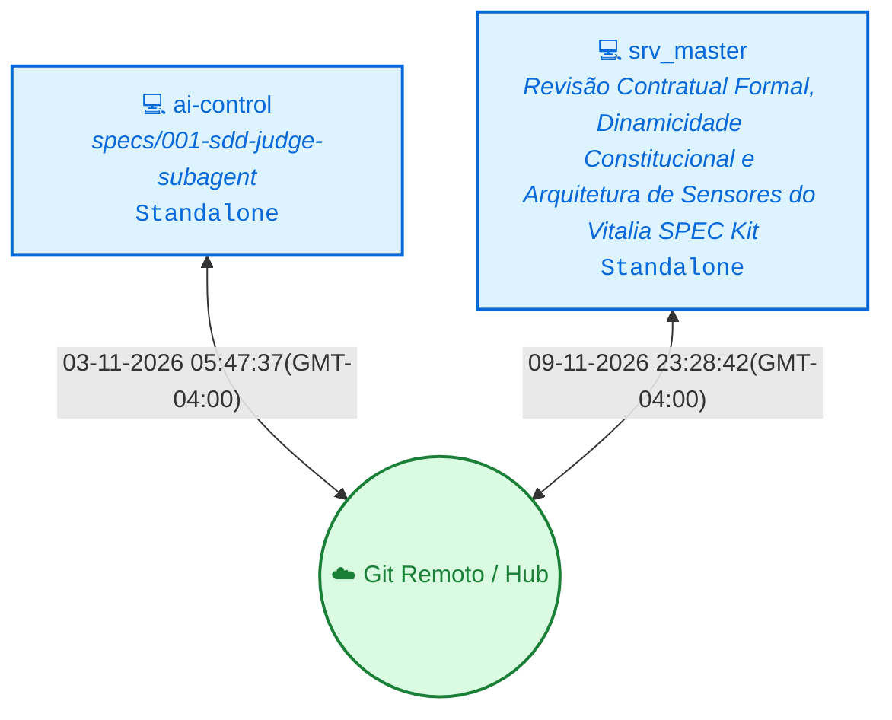

<!-- README.md | Atualizado em: 09-11-2026 23:31:25(GMT-04:00) -->

# 🧠 Painel de Contexto — vitalia-spec-kit

> **Vitalia Kit v0.5.0 — Ledger de Memória Persistente e Orquestração Multi-Máquina.**  
> Este repositório armazena o histórico distribuído, aprendizados consolidados e o controle de concorrência das sessões de trabalho do framework Vitalia.

---

## 📡 Topologia de Shards & Sincronização

---

## 🖥️ Máquinas e Status Atual

<table>
  <thead>
    <tr>
      <th align="left">Máquina / ID</th>
      <th align="left">Tarefa Atual</th>
      <th align="center">Ambiente</th>
      <th align="center">Status</th>
      <th align="left">Último Sync</th>
      <th align="left">Próximo Passo (P0)</th>
    </tr>
  </thead>
  <tbody>
    <tr>
      <td><strong>ai-control</strong> (<code>17a6f667</code>)</td>
      <td>specs/001-sdd-judge-subagent</td>
      <td align="center"></td>
      <td align="center">● Concluído</td>
      <td>03-11-2026 05:47:37(GMT-04:00)</td>
      <td><strong>Executar /vitalia-session-consolidate para consolidar os shards e renderizar o Dashboard</strong></td>
    </tr>
    <tr>
      <td><strong>srv_master</strong> (<code>eb10269b</code>)</td>
      <td>Revisão Contratual Formal, Dinamicidade Constitucional e Arquitetura de Sensores do Vitalia SPEC Kit</td>
      <td align="center"></td>
      <td align="center">● Concluído</td>
      <td>09-11-2026 23:28:42(GMT-04:00)</td>
      <td><strong>Iniciar no próximo turno a especificação SDD formal sequencial para implementar em código (source/) os contratos, novos schemas, scripts e testes validados nos documentos da pasta TEMP/</strong></td>
    </tr>
  </tbody>
</table>

---

## 🎯 Sessão Ativa em Destaque

- **Estação Ativa:** `ai-control` (`17a6f667`)
- **Tarefa em Execução:** specs/001-sdd-judge-subagent
- **🎯 Próximo Passo Prioritário (P0):** `Executar /vitalia-session-consolidate para consolidar os shards e renderizar o Dashboard`
- **Última Sincronização:** `03-11-2026 05:47:37(GMT-04:00)`

---

## 📚 Histórico, Decisões & Guard Rails

<strong>🔍 Clique para expandir o Histórico Completo de Sessões</strong>

 

| Data / Hora | Estação (ID) | Tarefa Executada | Próximo Passo (P0) |
| :--- | :--- | :--- | :--- |
| 09-11-2026 23:28:42(GMT-04:00) | `srv_master (eb10269b)` | Revisão Contratual Formal, Dinamicidade Constitucional e Arquitetura de Sensores do Vitalia SPEC Kit | `Iniciar no próximo turno a especificação SDD formal sequencial para implementar em código (source/) os contratos, novos schemas, scripts e testes validados nos documentos da pasta TEMP/` |
| 08-11-2026 21:48:52(GMT-04:00) | `srv_master (eb10269b)` | Spec 002: Universal Bootstrap Runtime | `Realizar teste de ponta a ponta da instalação do kit (kit-bootstrap.sh) em máquina limpa (WSL2/zsh) e avançar para a Spec 003.` |
| 07-11-2026 21:38:04(GMT-04:00) | `srv_master (eb10269b)` | Specs 002 + 003 + Ciclo Corretivo SDD (Âncora Unificada e Blindagem de Workflows) | `Regredir o repositório raiz para o estado íntegro da Spec 001 (git reset --hard 23bb91b) e conduzir o ciclo SDD unificado (Specs 002 + 003) via dogfooding dos novos workflows a partir da âncora .vitalia/memory/data_storage/research/anchor-research-brainstorming-002-003.md` |
| 2026-11-07T06:51:57.914397-04:00 | `servido ()` | 003-fix-universal-bootstrap-omissions | `Preparar release/tag ou iniciar a próxima spec sequencial do roadmap` |
| 2026-11-04T21:08:55.792475-04:00 | `servido ()` | Spec 002: Universal Bootstrap & Runtime (v0.0.1) | `Iniciar ciclo SDD da Spec 003: Especialistas Verticais & Capacidades Especializadas` |
| 03-11-2026 05:47:37(GMT-04:00) | `ai-control (17a6f667)` | specs/001-sdd-judge-subagent | `Executar /vitalia-session-consolidate para consolidar os shards e renderizar o Dashboard` |

<strong>⚖️ Clique para expandir as Decisões Arquiteturais Consolidadas</strong>

 

| Máquina (ID) | Decisão Arquitetural | Impacto / Racional |
| :--- | :--- | :--- |
| `eb10269b` | **[7449df5b]** `ARQUITETURA` Elevar a obrigatoriedade da flag --help didática com exemplos de uso a Princípio Constitucional Mandatório para 100% dos scripts executáveis e ferramentas CLI do Kit. | Garante acessibilidade e usabilidade para equipes multidisciplinares e pesquisadores sem background de engenharia profunda. |
| `eb10269b` | **[53189038]** `ARQUITETURA` Adotar a Vitalia Runtime Sensor Suite (VRSS) estruturada em 5 classes de sensores e pipeline de ingestão em 4 estágios com Structured Error Envelopes. | Fornece observabilidade em malha fechada para os agentes sem poluir a janela de contexto com dumps de terminal e tracebacks brutos. |
| `eb10269b` | **[b72cfc32]** `ARQUITETURA` Desacoplar o cálculo de ambiguidades de grounding_domains.yaml criando o perfil ambiguity_scoring.yaml e o schema ambiguity_scoring.schema.json, com cálculo determinístico via script sdd_ambiguity_scorer.py. | Preserva o Princípio da Responsabilidade Única (SRP) e elimina alucinações aritméticas em cálculos mentais da LLM. |
| `eb10269b` | **[dc086746]** `ARQUITETURA` Instituir Motor Dinâmico de Despacho de Sub-Agentes no vitalia-architect 100% guiado por agents_catalog.yaml (padrão vitalia-route). | Permite que novos especialistas adicionados ao catálogo sejam imediatamente utilizáveis pelo Arquiteto sem necessidade de alterar o prompt do architect.toml. |
| `eb10269b` | **[5c455455]** `ARQUITETURA` Padronização de esquemas em OpenAPI 3.0 puro sem propriedades de meta-schema ($schema, title de raiz, additionalProperties: false). | Compatibilidade universal com ferramentas de IA, SDKs e IDEs que rejeitam dialetos incompatíveis de JSON Schema. |
| `eb10269b` | **[23ce3811]** `ARQUITETURA` Política incondicional de Zero Poda (total_budget: 0, no_prune: true) para modelos de fronteira em todos os 16 workflows SDD e 14 perfis gp_*.yaml. | Modelos de fronteira suportam janelas amplas de contexto, garantindo que nenhuma regra constitucional ou diretiva seja perdida. |
| `eb10269b` | **[98aae91b]** `ARQUITETURA` Desacoplamento total de Redis local no Kit v0.0.1, utilizando envelopes de contexto direto em disco (.vitalia/memory/data_storage/context/<machine_id>/). | Elimina dependências de serviços e containers externos para desenvolvedores e pesquisadores sem infraestrutura pesada. |
| `eb10269b` | **[9d78edb0]** `PROJETO` Consolidar todas as especificações e contratos das Specs 002, 003 e do Ciclo Corretivo na âncora unificada .vitalia/memory/data_storage/research/anchor-research-brainstorming-002-003.md para reexecução limpa (dogfooding) a partir do commit íntegro da Spec 001 (23bb91b). | Evita alucinações por artefatos intermediários divergentes e permite validar o kit recém-blindado reconstruindo as Specs 002 e 003 do zero com governança completa. |
| `eb10269b` | **[a6e3da62]** `ARQUITETURA` Criar o Sub-Agente /vitalia-research (research.toml + gp_research.yaml) e calibrar grounding_domains.yaml em 10 domínios alinhados à stack de produção do ecossistema (incluindo ai-control). | Separa a responsabilidade de pesquisa profunda, Grounding Temporal (P03), validação HTTP 200 e Engenharia Reversa Funcional em 3 Camadas antes da especificação e planejamento. |
| `eb10269b` | **[f3067b6c]** `ARQUITETURA` Instituir a Matriz Bidimensional de Testes P05 com 4 Modalidades ([TEST:NEW], [TEST:BUGFIX], [TEST:REFACTOR], [TEST:MIGRATION]), Cenário de Falsificação obrigatório e bloqueio de testes sintáticos rasos. | Impede que features de infraestrutura/CLI e migrações passem na validação apenas verificando existência de arquivos sem testar execução real e regressão. |

<strong>🛡️ Clique para expandir os Guard Rails de Grounding e Domínios</strong>

 

| Arquivo de Regras | Status | Domínios Monitorados | Pendentes de Curadoria HITL |
| :--- | :---: | :--- | :---: |
| `grounding-domains.yaml` (Global) | ✅ Ativo | `llm_models`, `python_packages`, `external_apis`, `security_practices`, `regulations`, `cloud_services`, `scientific_claims` | — |
| `grounding-domains-local.yaml` (Projeto) | ✅ Sincronizado | Domínios locais específicos do workspace | `0 pendências` |

---

Painel gerado automaticamente pelo motor de contexto do Vitalia Kit (<code>vitalia_context_engine.py --action consolidate</code>).
