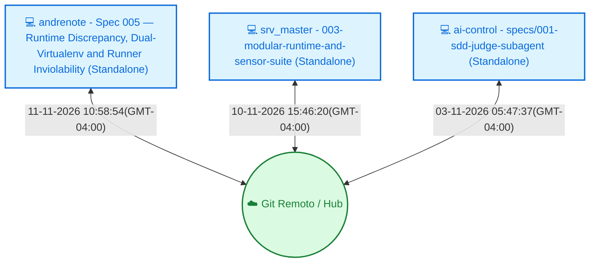

<!-- dashboard_template.md | Vitalia SPEC Kit v0.0.1 | 08-11-2026 20:12(GMT-04:00) -->
> **README.md | Vitalia SPEC Kit v0.0.1 | 11-11-2026 11:04:06(GMT-04:00)**

# 🧠 Painel de Contexto — vitalia-spec-kit

> **Vitalia SPEC Kit v0.0.1 — Ledger de Memória Persistente e Orquestração Multi-Máquina.**  
> Este repositório armazena o histórico distribuído, aprendizados consolidados e o controle de concorrência das sessões de trabalho do framework Vitalia.

---

## 📡 Topologia de Shards & Sincronização

---

## 🖥️ Máquinas e Status Atual

<table>
  <thead>
    <tr>
      <th align="left">Máquina / ID</th>
      <th align="left">Tarefa Atual</th>
      <th align="center">Ambiente</th>
      <th align="center">Status</th>
      <th align="left">Último Sync</th>
      <th align="left">Próximo Passo (P0)</th>
    </tr>
  </thead>
  <tbody>
    <tr>
      <td><strong>andrenote</strong> (<code>7f367bd3</code>)</td>
      <td>Spec 005 — Runtime Discrepancy, Dual-Virtualenv and Runner Inviolability</td>
      <td align="center"></td>
      <td align="center">● Concluído</td>
      <td>11-11-2026 10:58:54(GMT-04:00)</td>
      <td><strong>Teste real de inicialização de sessão (/vitalia-session-start) e consolidação em ambiente operacional</strong></td>
    </tr>
    <tr>
      <td><strong>srv_master</strong> (<code>eb10269b</code>)</td>
      <td>003-modular-runtime-and-sensor-suite</td>
      <td align="center"></td>
      <td align="center">● Concluído</td>
      <td>10-11-2026 15:46:20(GMT-04:00)</td>
      <td><strong>Realizar teste de ponta a ponta da instalação do kit na máquina nova</strong></td>
    </tr>
    <tr>
      <td><strong>ai-control</strong> (<code>17a6f667</code>)</td>
      <td>specs/001-sdd-judge-subagent</td>
      <td align="center"></td>
      <td align="center">● Concluído</td>
      <td>03-11-2026 05:47:37(GMT-04:00)</td>
      <td><strong>Executar /vitalia-session-consolidate para consolidar os shards e renderizar o Dashboard</strong></td>
    </tr>
  </tbody>
</table>

---

## 🎯 Sessão Ativa em Destaque

- **Estação Ativa:** `andrenote` (`7f367bd3`)
- **Tarefa em Execução:** Spec 005 — Runtime Discrepancy, Dual-Virtualenv and Runner Inviolability
- **🎯 Próximo Passo Prioritário (P0):** `Teste real de inicialização de sessão (/vitalia-session-start) e consolidação em ambiente operacional`
- **Última Sincronização:** `11-11-2026 10:58:54(GMT-04:00)`

---

## 📚 Histórico, Decisões & Guard Rails

<strong>🔍 Clique para expandir o Histórico Completo de Sessões</strong>

 

| Data / Hora | Estação (ID) | Tarefa Executada | Próximo Passo (P0) |
| :--- | :--- | :--- | :--- |
| 11-11-2026 10:58:54(GMT-04:00) | `andrenote (7f367bd3)` | Spec 005 — Runtime Discrepancy, Dual-Virtualenv and Runner Inviolability | `Teste real de inicialização de sessão (/vitalia-session-start) e consolidação em ambiente operacional` |
| 10-11-2026 20:17:46(GMT-04:00) | `andrenote (7f367bd3)` | Spec 004 — Pre-Flight Check, Isolamento Estrito do .venv e Observabilidade Passo a Passo na Instalação | `Executar /vitalia-session-consolidate para sincronizar os shards e compilar o Dashboard, ou iniciar nova feature SDD` |
| 10-11-2026 15:46:20(GMT-04:00) | `srv_master (eb10269b)` | 003-modular-runtime-and-sensor-suite | `Realizar teste de ponta a ponta da instalação do kit na máquina nova` |
| 09-11-2026 23:28:42(GMT-04:00) | `srv_master (eb10269b)` | Revisão Contratual Formal, Dinamicidade Constitucional e Arquitetura de Sensores do Vitalia SPEC Kit | `Iniciar no próximo turno a especificação SDD formal sequencial para implementar em código (source/) os contratos, novos schemas, scripts e testes validados nos documentos da pasta TEMP/` |
| 08-11-2026 21:48:52(GMT-04:00) | `srv_master (eb10269b)` | Spec 002: Universal Bootstrap Runtime | `Realizar teste de ponta a ponta da instalação do kit (kit-bootstrap.sh) em máquina limpa (WSL2/zsh) e avançar para a Spec 003.` |
| 07-11-2026 21:38:04(GMT-04:00) | `srv_master (eb10269b)` | Specs 002 + 003 + Ciclo Corretivo SDD (Âncora Unificada e Blindagem de Workflows) | `Regredir o repositório raiz para o estado íntegro da Spec 001 (git reset --hard 23bb91b) e conduzir o ciclo SDD unificado (Specs 002 + 003) via dogfooding dos novos workflows a partir da âncora .vitalia/memory/data_storage/research/anchor-research-brainstorming-002-003.md` |
| 2026-11-07T06:51:57.914397-04:00 | `servido ()` | 003-fix-universal-bootstrap-omissions | `Preparar release/tag ou iniciar a próxima spec sequencial do roadmap` |
| 2026-11-04T21:08:55.792475-04:00 | `servido ()` | Spec 002: Universal Bootstrap & Runtime (v0.0.1) | `Iniciar ciclo SDD da Spec 003: Especialistas Verticais & Capacidades Especializadas` |
| 03-11-2026 05:47:37(GMT-04:00) | `ai-control (17a6f667)` | specs/001-sdd-judge-subagent | `Executar /vitalia-session-consolidate para consolidar os shards e renderizar o Dashboard` |

<strong>⚖️ Clique para expandir as Decisões Arquiteturais Consolidadas</strong>

 

| Máquina (ID) | Decisão Arquitetural | Impacto / Racional |
| :--- | :--- | :--- |
| `7f367bd3` | **[302f047e]** `ARQUITETURA` Auto-substituição defensiva no Hook Runner: Interceptação automática de chamadas python3 para sys.executable quando o alvo for utilitário interno do kit. | Blinda a execução de workflows legados ou extensões mesmo em terminais com PATH corrompido ou sem pacotes do kit instalados no Python global. |
| `7f367bd3` | **[daac3d87]** `ARQUITETURA` Desacoplamento estrito Dual-Runtime: {{KIT_PYTHON}} para governança interna do kit em ${VITALIA_KIT_DIR}/.venv e {{PROJECT_PYTHON}} para a aplicação cliente com busca em 4 níveis e fallback dinâmico. | Isola completamente as dependências da ferramenta de governança das dependências da aplicação hospedeira, eliminando conflitos de pacotes. |
| `7f367bd3` | **[d00e5b8a]** `ARQUITETURA` ADR-0003 — Pre-flight check modular, isolamento estrito do .venv e observabilidade passo a passo | Criação da biblioteca source/bin/lib/preflight.sh compartilhada entre kit-bootstrap.sh e install-project, purga definitiva de --system-site-packages, logs isolados por UID em /tmp e banner contextual de shell. |
| `eb10269b` | **[7a77ad93]** `ARQUITETURA` Centralização de backups e manifestos gerados pelo instalador na Camada 4 (.vitalia/memory/data_storage/). | Garante pureza de 100% na árvore de skills da IDE (.agents/skills/) e na raiz de .vitalia/, impedindo arquivos soltos ou ocultos residuais. |
| `eb10269b` | **[b2989966]** `ARQUITETURA` Desacoplamento da limpeza de temporários do hook runner de contexto para uma ferramenta CLI independente (vitalia_tmp_cleanup.py). | Elimina matriz de limpeza de temporários dentro do payload de contexto, acabando com o ruído e sequestro de atenção cognitiva dos modelos. |
| `eb10269b` | **[7449df5b]** `ARQUITETURA` Elevar a obrigatoriedade da flag --help didática com exemplos de uso a Princípio Constitucional Mandatório para 100% dos scripts executáveis e ferramentas CLI do Kit. | Garante acessibilidade e usabilidade para equipes multidisciplinares e pesquisadores sem background de engenharia profunda. |
| `eb10269b` | **[53189038]** `ARQUITETURA` Adotar a Vitalia Runtime Sensor Suite (VRSS) estruturada em 5 classes de sensores e pipeline de ingestão em 4 estágios com Structured Error Envelopes. | Fornece observabilidade em malha fechada para os agentes sem poluir a janela de contexto com dumps de terminal e tracebacks brutos. |
| `eb10269b` | **[b72cfc32]** `ARQUITETURA` Desacoplar o cálculo de ambiguidades de grounding_domains.yaml criando o perfil ambiguity_scoring.yaml e o schema ambiguity_scoring.schema.json, com cálculo determinístico via script sdd_ambiguity_scorer.py. | Preserva o Princípio da Responsabilidade Única (SRP) e elimina alucinações aritméticas em cálculos mentais da LLM. |
| `eb10269b` | **[dc086746]** `ARQUITETURA` Instituir Motor Dinâmico de Despacho de Sub-Agentes no vitalia-architect 100% guiado por agents_catalog.yaml (padrão vitalia-route). | Permite que novos especialistas adicionados ao catálogo sejam imediatamente utilizáveis pelo Arquiteto sem necessidade de alterar o prompt do architect.toml. |
| `eb10269b` | **[5c455455]** `ARQUITETURA` Padronização de esquemas em OpenAPI 3.0 puro sem propriedades de meta-schema ($schema, title de raiz, additionalProperties: false). | Compatibilidade universal com ferramentas de IA, SDKs e IDEs que rejeitam dialetos incompatíveis de JSON Schema. |

<strong>🛡️ Clique para expandir os Guard Rails de Grounding e Domínios</strong>

 

| Arquivo de Regras | Status | Domínios Monitorados | Pendentes de Curadoria HITL |
| :--- | :---: | :--- | :---: |
| `grounding_domains.yaml` (Global) | ✅ Ativo | `provedores_de_ia`, `python_packages`, `web_technologies`, `external_apis`, `security_practices`, `regulations_compliance`, `cloud_services`, `scientific_claims`, `clinical_safety`, `software_architecture` | — |
| `grounding-domains-local.yaml` (Projeto) | ✅ Sincronizado | Domínios locais específicos do workspace | `0 pendências` |

---

Painel gerado automaticamente pelo motor de contexto do Vitalia Kit (<code>vitalia_context_engine.py --action consolidate</code>).
